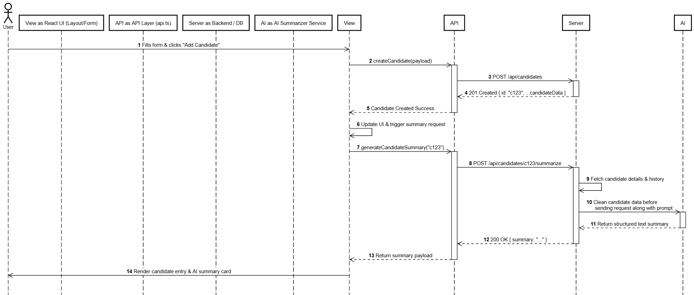

# Write-up: Candidate Tracker

## What I built

A candidate tracker with a Java (Spring Boot) REST API and a React (TypeScript, Vite) front end. Candidates can be added, filtered by stage and role, sorted by date added or stage, moved between stages, given append-only timestamped notes, and deleted. Each candidate's page shows an AI-generated summary of their resume in a separate panel.

## Design choices

- **Layered backend in one Maven module:** domain, then repository (an interface plus an in-memory implementation), then service, then controller. I chose one module with package boundaries because the packages give the same separation with far less complexity.
- **Domain driven design:** modelling the software around the business requirements by starting with the domain, and encapsulating in controller, server, and view packages. Allows for framework independence, easy testing, and clear separation of concerns. 
- **Built test-first from the domain outward.** Plain JUnit tests for `Candidate`, then the repository, service and controllers. Controller tests use standalone MockMvc with the real service and in-memory repository.
- **Records** were used to enforce completeness and reduce verbosity of code. They increase clarity of API endpoint request data.
- **Notes are `Note` objects (text and timestamp) in an unmodifiable list,** so they are append-only and can be returned as structured JSON. The service owns the clock and passes the time in, which keeps `Candidate` free of infrastructure and makes timestamp tests deterministic.
- **Filtering and sorting happen on the server,** and the front end re-fetches after any change so the list always matches the server. This keeps a single source of truth and means the client only needs to download the specific data they requested.
- **Front end:** a split layout (sidebar with filters and list, detail pane on the right) built with nested routes, so each view has its own URL and the back button works. In development, Vite proxies `/api` to the backend, which avoids CORS configuration.
- **Delete rather than archive,** since the brief allows either. I kept scope tight; archiving would preserve history and allow restoring a candidate.

## Sequence Diagram

## How the AI feature is integrated

The feature lives in one `summary` package and one front-end component, so it can be explained in isolation.

- **API:** `POST /api/candidates/{id}/summary` returns `{status, text}` where status is `GENERATED`, `NO_RESUME_TEXT` or `UNAVAILABLE`. It always answers 200 for these cases so the page can show a distinct message for each, and 404 only for an unknown candidate.
- **Provider:** Google's Gemini API (Interactions API over plain HTTP), chosen because it has a free tier. It sits behind a one-method `TextGenerator` interface, so the provider can be swapped and tests use a fake. The model name and API key are configuration, the key lives in a git-ignored `.env`, and the app runs without a key (the summary shows as unavailable). I set `store: false` so requests are not retained by the provider.
- **Prompt design:** the instructions are sent separately from the resume. The resume is wrapped in `<resume>` tags and described as untrusted data. The prompt asks for 3 to 5 plain-text bullets, forbids inventing facts, and forbids hiring recommendations or inferences about personal characteristics.
- **Handling bad input:** control characters are removed, any `<resume>` tags inside the text are stripped (so it cannot close the wrapper early), text is cut to 12,000 characters, and empty input never calls the AI. Replies are trimmed and capped at 1,000 characters, and provider errors or blank replies become `UNAVAILABLE` instead of an error.
- **Safe display:** the summary and the resume are rendered as plain text, and the model's output never triggers any action (it cannot change a stage, for example). The worst case of a successful injection is a misleading summary.

## Trade-offs

- **In-memory storage** keeps setup to a few commands but loses data on restart.
- **Summaries are generated on demand and not stored,** so each page view costs a provider call and quota. The panel only calls the AI when there is resume text.
- **Free tier:** Google's terms allow free-tier content to be used to improve its products, so only made-up data is used. A real deployment needs a paid tier or a provider with a data-processing agreement.
- **Domain objects are returned directly as JSON,** which is quick but exposes internal shape. Separate response objects would be cleaner.
- **No front-end tests** and no archive feature, to protect the working end-to-end slice.

## What I'd build next

1. Persistence with PostgreSQL through JPA, plus an integration test (today the in-memory tests would pass even if the service forgot to call `save`).
2. Implement a schema that holds two tables: Candidates and Notes.
2. Store each summary on the candidate and refresh it only when the resume text changes.
3. Improve the prompt so the model says when text is garbled, contradictory or contains instructions aimed at an AI, then re-run the sample set.
4. Authentication, rate limiting and an audit trail for the AI endpoint.
5. Front-end tests, an archive option with a restore, and PDF resume upload.
